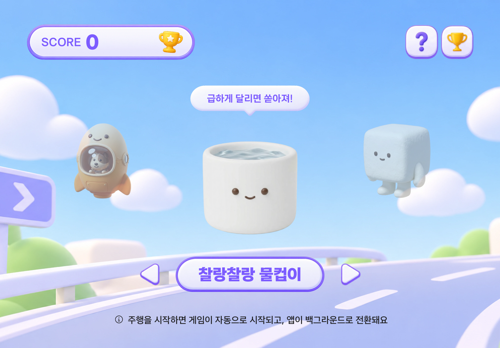
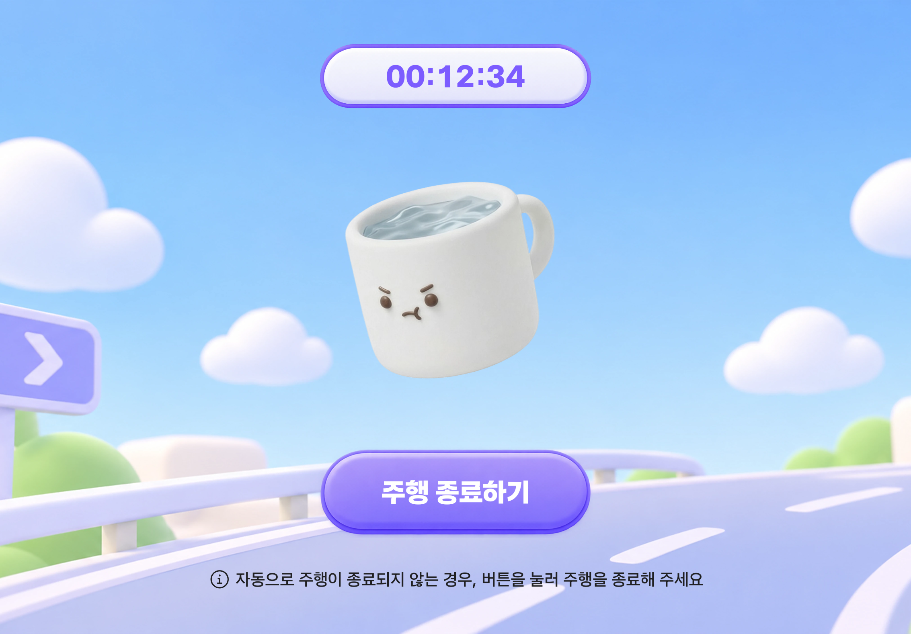
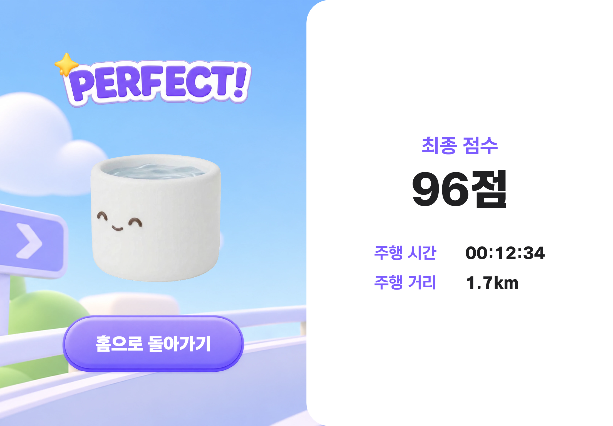
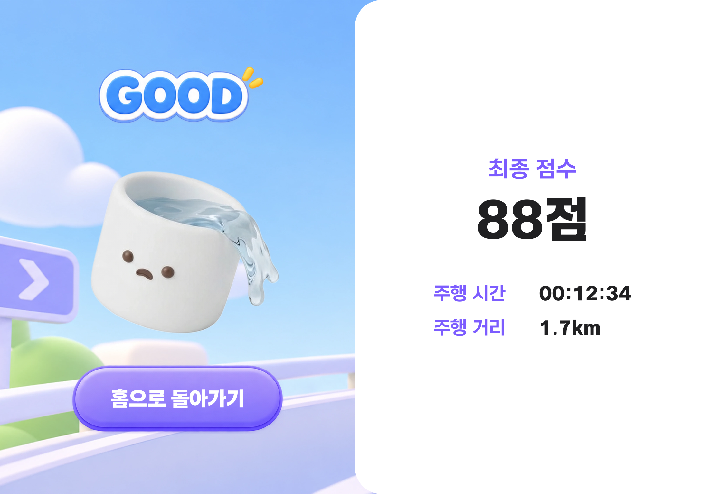
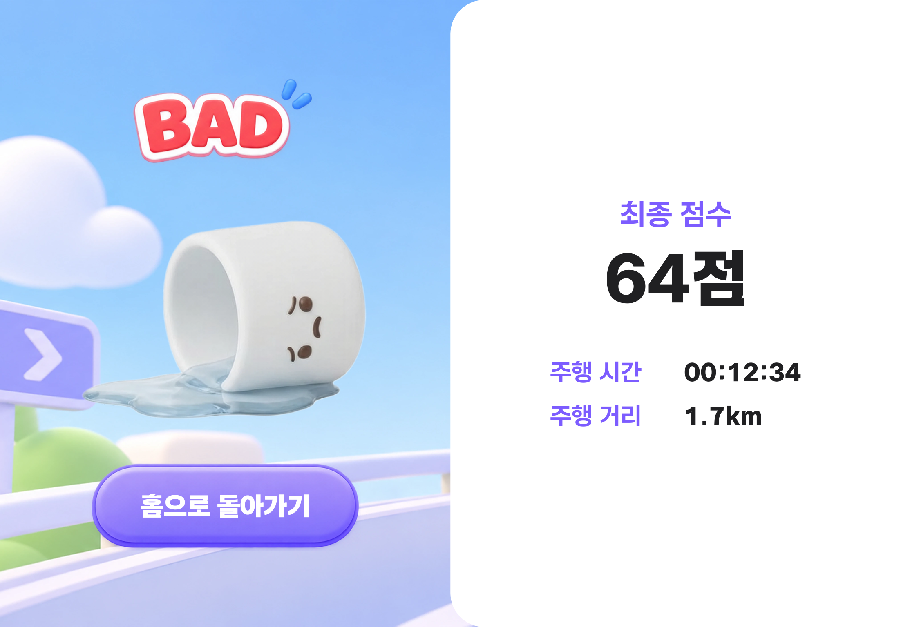
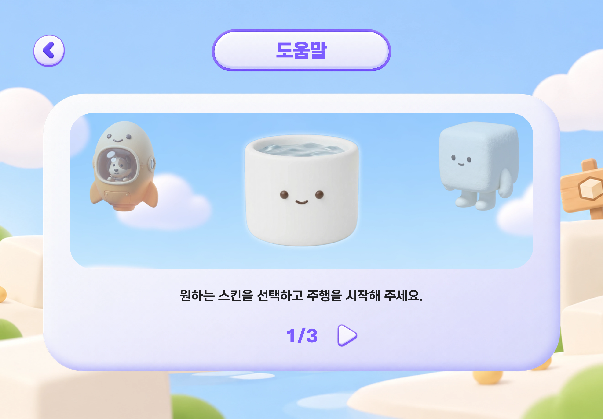
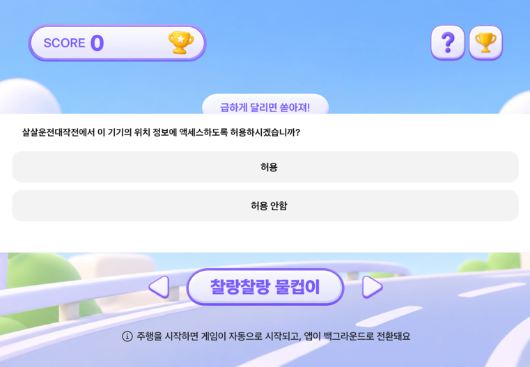
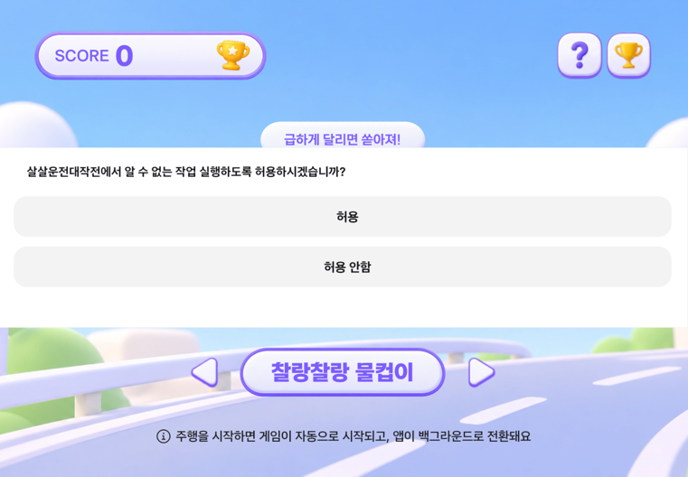

# 살살운전대작전

물 한 방울도 쏟지 않는 운전, 가능할까요?  
“**살살운전대작전**”은 차량 데이터를 유쾌한 캐릭터 피드백과 리워드로 연결하는 **차량용 안전운전 앱**입니다.


## 화면 구성
### 화면 흐름

| 홈 | 주행 | 결과 |
| --- | --- | --- |
|  |  |  |

※ 주행 종료를 자동으로 감지하지 못한 경우 앱을 켰을 때 주행 화면이 보이며, "주행 종료하기" 버튼으로 직접 주행을 종료할 수 있습니다.

### 결과 등급

| PERFECT | GOOD | BAD |
| --- | --- | --- |
|  |  |  |

### 캐릭터별 스킨

| 찰랑찰랑 물컵이 | 뭉게뭉게 순두부 | 위기탈출 개복치 | 우주여행 라이카 |
| --- | --- | --- | --- |
|  |  |  |  |

### 도움말과 리더보드

| 도움말 | 리더보드 |
| --- | --- |
|  |  |

※ 홈 화면의 우측 상단 아이콘을 통해 확인할 수 있습니다.

<br>

## 테스트 환경

| 항목 | 값 |
| --- | --- |
| 에뮬레이터 | Pleos Connect v2.1.0 (Android 14) |
| 화면 규격 | S-17 (가로 1700×1184dp, 세로 840×1184dp) |
| minSdk / targetSdk | 28 / 35 |
| 빌드 도구 | Android Studio, Gradle 9.4.1, AGP 9.2.1, Kotlin 2.4.21 |

<br>

## 실행 방법

### 1. 에뮬레이터 준비

Pleos Connect v2.1.0 에뮬레이터를 실행합니다.

### 2. APK 설치

APK 위치: `apk/요즘피플_살살운전대작전_release.apk`

```bash
adb install apk/요즘피플_살살운전대작전_release.apk
```


### 3. 앱 실행과 권한 허용

앱 목록에서 **살살운전대작전**을 실행합니다. 권한 팝업 두 개(위치 정보 액세스, 알 수 없는 작업)를 모두 허용합니다.  
자세한 내용은 아래 [필요한 설정과 권한](#필요한-설정과-권한)에 있습니다.

### 4. 캐릭터 선택

홈 화면에서 좌우 화살표로 이번 주행을 함께할 캐릭터를 선택합니다.  
선택한 캐릭터에 맞춰 스킨(배경)이 바뀌고, 선택된 스킨은 모든 화면에 적용됩니다.

### 5. 주행

에뮬레이터에서 테스트를 하는 경우 위치 변화가 없으므로 주행 종료 시 주행 거리가 0.0km으로 나옵니다.  
주행 거리를 함께 테스트하기 위해서는 주행 시작 전 경로(GPX)를 에뮬레이터에서 같이 재생해야 합니다. [테스트 경로 재생](#테스트-경로-재생)을 참고합니다.

1. Pleos 가상 콘솔을 이용하여 주행을 준비합니다. 가상 콘솔 설치와 사용법은 [Pleos 가상 콘솔 가이드](https://document.pleos.ai/docs/pleos-only/app-test-guide/virtual-console-guide)를 참고합니다.
2. 기어를 D로 바꾸고 차속을 올려 5초 이상 유지하면 앱 내부에서 주행 시작으로 판단됩니다.
3. 급가속·급감속을 하거나 다양한 요소를 활용하여 주행을 계속합니다. 3초 안에 차속을 30km/h 이상 올리거나 내리면 급가속·급감속으로 감점됩니다.

### 6. 결과 확인

가상 콘솔에서 기어를 P로 바꾸면 주행이 종료됩니다. 앱을 열어 결과 화면에서 점수, 등급, 주행 시간, 주행 거리를 확인할 수 있습니다.  
자동으로 주행 종료 감지가 되지 않은 경우, 주행 화면에서 "주행 종료하기" 버튼을 눌러 결과를 확인할 수 있습니다.


### 7. 앱을 열지 않고 주행하기

권한을 허용해 두면(첫 설치 시 권한 허용 필수) 차가 켜질 때부터 앱을 열지 않아도 주행을 기록합니다.  
`adb reboot`로 에뮬레이터를 재부팅한 뒤 앱을 열지 않은 채 5, 6단계를 다시 진행하면, 기본 캐릭터(찰랑찰랑 물컵이)로 자동 선택되어 결과를 확인할 수 있습니다.

<br>

## 필요한 설정과 권한

앱을 처음 실행하면 권한 팝업 두 개가 요청되며, 둘 다 허용해야 앱의 기능을 이용할 수 있습니다.

| 1. Car Speed 권한                                                                | 2. Fused Location 권한                                                                            |
|--------------------------------------------------------------------------------|-------------------------------------------------------------------------------------------------|
|  |  |

1. **위치 정보 액세스**: 차속 권한(`CAR_SPEED`)입니다. Android가 차속 권한을 위치 그룹으로 분류해서 위치 권한 팝업으로 보입니다.
2. **알 수 없는 작업**: Pleos FusedLocation SDK를 사용하기 위한 위치 데이터 접근 권한입니다.

<br>

## 테스트 경로 재생

에뮬레이터에서 주행 거리 값을 테스트하기 위한 GPX 경로 재생 방법입니다.  
`testRoutes/seoul_drive.gpx`는 서울 시내 약 8km를 40km/h로 달리는 경로(약 12분)입니다.

1. 프로젝트 경로의 `testRoutes/seoul_drive.gpx`를 확인합니다.
2. Running Devices 화면 상단 도구 막대의 **⋮**(Extended Controls)를 누르고 **Location**을 클릭합니다.
3. **Routes** 탭에서 **IMPORT GPX/KML**을 눌러 GPX 파일을 선택합니다.
4. 불러온 경로를 선택하고 **Playback speed**는 1X로 둡니다.
5. 5-2단계에서 주행을 시작하기 전에 **PLAY ROUTE**를 눌러 경로 재생을 시작하고, 지도에서 위치가 서울로 옮겨져 움직이는 것을 확인한 뒤 주행을 시작합니다.
6. 주행을 마친 후 결과를 확인하고 에뮬레이터의 **STOP ROUTE**를 눌러 경로 재생을 종료합니다.

